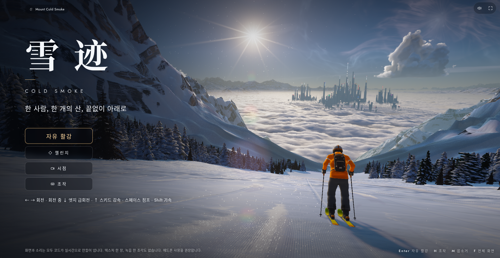
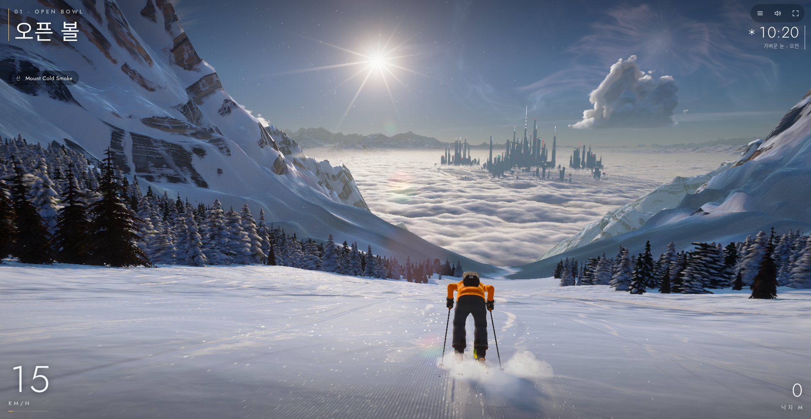

# 雪迹 Cold Smoke — 한국어판

> 원작: [huiskylabs/cold-smoke](https://github.com/huiskylabs/cold-smoke) (MIT License, © 2026 Huisky)
> 원작 플레이: https://huisky.xyz/cold-smoke/play
> 이 저장소는 원작을 한국어로 번역한 포크입니다. 원작자의 코드·에셋 권리는 MIT 라이선스에 따라 원작자에게 있으며, 라이선스 전문은 [LICENSE](LICENSE)에 그대로 보존되어 있습니다.

**플레이:** https://sigco3111.github.io/cold-smoke/

원문 README(영어·중국어)는 [README.en-zh.md](README.en-zh.md)에 그대로 보존되어 있습니다.

---

## 게임 소개

「雪迹 Cold Smoke」는 밤 산을 배경으로 한 3D 스키·스노보드 활강 게임입니다. 브라우저에서 바로 실행되며, 별도의 설치나 로그인이 필요 없습니다.

- 매일 바뀌는 **오늘의 산**에서 전 세계 플레이어가 같은 코스를 달립니다.
- **속강 코스**와 **크로스컨트리 코스** 두 가지 라인, 각각 쉬움·표준·어려움 세 난이도.
- 코스 위의 **링(光圈)** 을 통과하면 시간 보너스를 받습니다.
- 활강이 끝나면 내 라인을 담은 **루트 카드**가 만들어지고, 브라우저에 기록이 저장됩니다.
- 스키/스노보드 장비와 라이더 스타일, 눈 질감·날씨·시간대까지 세밀하게 조정할 수 있는 설정과 개발자용 버전 비교 페이지(versions)가 포함되어 있습니다.

모든 그래픽과 사운드는 코드로 생성됩니다(이미지·오디오 파일 없음). 빌드 결과는 `index.html` 단일 파일 하나입니다.

## 스크린샷

한국어판 배포 빌드(https://sigco3111.github.io/cold-smoke/)에서 직접 캡처한 실행 화면입니다.

| 타이틀 화면 | 활강 화면 (오픈 볼) |
| --- | --- |
|  |  |

## 한국어판 안내

- **새 방문자는 기본으로 한국어**가 표시됩니다.
- 기존 언어 전환은 그대로 유지됩니다. 메뉴의 언어 버튼으로 **中文 → English → 한국어** 순서로 순환하며, 선택은 브라우저에 저장됩니다. URL에 `?lang=zh|en|ko`를 붙여 강제할 수도 있습니다.
- 게임 내 일반 웹 UI(메뉴, HUD, 결과 화면, 루트 카드, 버전 비교 페이지 등)의 문구를 한국어로 번역했습니다. 원문 문자열과 영어 번역은 모두 그대로 유지되어 있어 언제든 원래 언어로 돌아갈 수 있습니다.
- 한국어 표기에는 시스템 세리프체를 사용합니다(원작에 내장된 중국어 폰트 서브셋에는 한글이 없습니다). 타이틀의 「雪迹」 로고 등 원작 브랜드 표기는 원형을 유지했습니다.

### 번역에서 제외한 범위

- **샤오홍슈(小红书) 미니앱 전용 문자열**: 순위표·공유 등 미니앱 컨테이너 안에서만 렌더링되는 문자열은 일반 웹 배포에서 표시되지 않으므로 번역하지 않았습니다.
- **개발자용 실험 페이지**(human lab 등) 내부 데이터 문자열: 게임 화면에 표시되지 않는 개발 도구 영역입니다.

## 조작 방법

| 입력 | 동작 |
| --- | --- |
| ← / → (또는 A / D) | 턴 |
| ↓ (또는 S) | 속도 줄이기 |
| ↑ (또는 W) | 폴 푸시(평지) |
| Space | 점프 |
| Esc | 일시정지 / 메뉴 |
| Enter | 다시 시작 |

모바일에서는 화면 좌우를 터치해 턴합니다.

## 개발·빌드

소스는 `src/`의 순수 자바스크립트와 `template.html`로 이루어져 있으며, 빌드 스크립트가 하나의 HTML 파일로 합칩니다.

```bash
npm install esbuild   # 빌드 도구
node build.js         # dist/index.html 생성
```

배포된 `index.html`은 이렇게 빌드한 결과물입니다.

## 원작과의 차이

1. 새 방문 기본 언어를 한국어로 변경(기존 zh/en 전환 유지).
2. 한국어 사전(KO) 추가 — 기존 사전 구조 재사용, 기능 변경 최소화.
3. 한국어 폰트 스택 및 문자 간격 CSS 추가.
4. 루트 카드·링 HUD 등 일부 캔버스 문자열의 번역 경로 보강.

게임 규칙, 물리, 코스 생성 등 게임 본연의 동작은 원작과 동일합니다.

---

*This is a Korean localization fork of huiskylabs/cold-smoke (MIT). All credit for the original game goes to the original author. The original bilingual README is kept as README.en-zh.md.*
